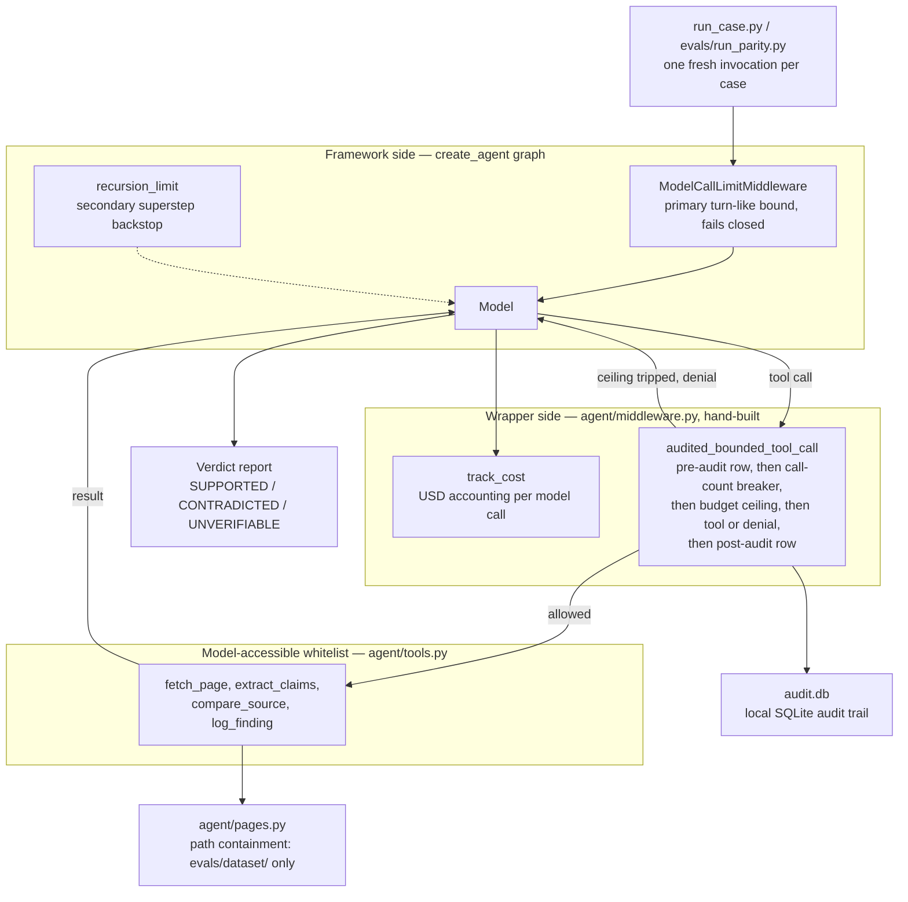

# ai-claim-verification-langgraph

[](https://github.com/kobescak-kristian/ai-claim-verification-langgraph/actions/workflows/ci.yml)

A LangGraph port of [ai-claim-verification-agent](https://github.com/kobescak-kristian/ai-claim-verification-agent) — the same bounded claim-verification agent, rebuilt on LangChain v1 / LangGraph's `create_agent`, facing the identical frozen eval the origin already passed. One variable changes: the framework.

**Parity result: precision 1.00 / recall 1.00 — Sonnet 4.6, official run 2026-07-20**, identical to the origin's gate (12 cases / 35 synthetic claims, $0.63 total run cost). Full per-case results: [`evals/parity_run_2026-07-20.md`](evals/parity_run_2026-07-20.md).

**Re-run with neutral case names, 2026-10-13: precision 1.00 / recall 1.00 (35/35), $0.61.** Until 2026-10-13, 8 of the 12 eval case directory names contained a verdict word (`supported`, `contradicted` or `unverifiable`) that reached the model. The re-run uses neutral names (`case_01` to `case_12`) with the same scorer, thresholds and model, and the origin's re-run scored the same. The cases remain synthetic. Record: [`evals/rerun_2026-10-13.md`](evals/rerun_2026-10-13.md).

**Synthetic, labeled data by design. This system has not been deployed and carries no production or availability claim.** The eval proves the harness and the ported cage hold against controlled, known-truth claims — it does not prove behavior on live web content.

**→ [`COMPARISON.md`](COMPARISON.md): what the framework gives, what it hides, what it cannot enforce — the actual deliverable of this port.**

## Problem

The origin's problem statement is unchanged by the port: content pages make factual claims that should match their sources but usually go unchecked, and an unbounded agent can't be trusted to do that checking near live content. See the [origin's README](https://github.com/kobescak-kristian/ai-claim-verification-agent#problem) for the full framing.

This repo asks a narrower, second question: if you rebuild the same bounded agent on a popular agent framework instead of hand-rolling it, does the safety cage survive the move, and does the framework help or get in the way?

## Solution

Same target/source page model, same four read-only tools (`fetch_page`, `extract_claims`, `compare_source`, `log_finding`), same verdict set (SUPPORTED / CONTRADICTED / UNVERIFIABLE), same comparison policy loaded at runtime from [`evals/eval_config.yaml`](evals/eval_config.yaml) — ported, not rewritten. The agent is built with LangChain v1's `create_agent`; a manual `StateGraph` was never needed because no cage property required dropping below the framework.

## System



The split in that diagram is the finding, not an implementation detail. The framework carries the tool whitelist, the model-call cap and the hook point where auditing attaches; the USD ceiling and the call-count breaker are hand-built in the wrapper layer because no framework primitive exists for them. Every tool call the model makes passes through the wrapper gate, which writes an audit row before the tool runs or is denied. [`COMPARISON.md`](COMPARISON.md#the-cage-component-by-component) argues what that split means.

### The Cage — translated, not assumed

Five bounds carry over from the origin. Two are pre-registered as testable predictions in [`decisions/0001`](decisions/0001-port-target-and-parity-contract.md), settled with the installed framework in [`decisions/0002`](decisions/0002-p1-technical-rulings.md), and their locus is reported in [`COMPARISON.md`](COMPARISON.md#the-cage-component-by-component) — one prediction held, two were falsified by primitives that turned out to exist:

- **Tool whitelist** — the list passed to `create_agent` *is* the whitelist; no built-in Write/Bash/Edit exists to disable.
- **Turn cap** — `ModelCallLimitMiddleware(run_limit=20, exit_behavior="error")`, fail closed, with a sized `recursion_limit` as a secondary backstop.
- **USD budget ceiling** — hand-built in the tool-wrapper layer; no framework primitive exists for it.
- **Call-count circuit breaker** — hand-built, kept per pre-registration even though `ToolCallLimitMiddleware` exists.
- **Audit-before-use** — a `wrap_tool_call` middleware writes a SQLite pre-row, invokes the tool, writes a post-row, then returns. [`tests/test_bounds.py`](tests/test_bounds.py) proves this mechanically through the real middleware-wrapped execution path (not a bare tool call) — the same escape-attempt, leak-marker, and cap-enforcement checks as the origin's bounds suite.

### Eval wiring

Eval artifacts (dataset, ground truth, eval config, scorer) are copied verbatim from the origin — zero changes. LangSmith observes via trace export; it never scores. See [`decisions/0003`](decisions/0003-p3-trace-archive-and-run-protocol.md) for why a committed JSON export, not a dashboard link, is the archive: Developer-tier traces expire from the UI/API in ~14 days.

## Outcome

**Official parity run — Sonnet 4.6, 2026-07-20** ([full report](evals/parity_run_2026-07-20.md)):

| Metric | Value | Threshold | Result |
|---|---|---|---|
| Precision (positive class: CONTRADICTED) | 1.0000 (8/8) | ≥ 0.95 | PASS |
| Recall (positive class: CONTRADICTED) | 1.0000 (8/8) | ≥ 0.90 | PASS |
| Overall verdict accuracy (secondary, not gated) | 1.0000 (35/35) | — | — |

12 cases / 35 claims, $0.6332 total run cost, no case hit the turn cap or the budget ceiling. Trace archive: [`evals/traces/p3_official_2026-07-20/`](evals/traces/p3_official_2026-07-20/).

Re-run with neutral case directory names, 2026-10-13 ([record](evals/rerun_2026-10-13.md)): precision 1.0000 (8/8), recall 1.0000 (8/8), 35/35, $0.6139 total, none capped, tracing off.

Harness-layer code size, measured on `agent/*.py` alone (tests and eval assets excluded, re-measured 2026-07-24): **509 lines in the origin, 585 in this port — 15% more, not less.** The framework relocated cage enforcement into an explicit middleware layer; it didn't shrink the agent. Full breakdown in [`COMPARISON.md`](COMPARISON.md#what-id-tell-you-in-an-interview).

## Run It Yourself

```bash
python -m venv .venv
.venv/Scripts/activate   # or: source .venv/bin/activate  (macOS/Linux)
pip install -r requirements.txt
```

Copy `.env.example` to `.env` and set `ANTHROPIC_API_KEY` (this port bills via a per-token API key, not Claude subscription auth — a deliberate difference from the origin, noted in [`COMPARISON.md`](COMPARISON.md#what-the-framework-cannot-enforce)). LangSmith variables are optional; tracing stays off (`LANGSMITH_TRACING=false`) unless you're reproducing the traced parity run yourself.

**Bounds suite** — 22 tests. 21 need no prior run and no API key; the other 1 (`test_every_audit_path_resolves_inside_dataset`) reads a local `audit.db` and is skipped until one exists. Runs in CI on every push — Ubuntu, macOS and Windows, Python 3.12 and 3.14:

```bash
pytest tests/test_bounds.py -v
```

**Single-case demo** (calls the API):

```bash
python run_case.py case_09
```

**Full parity run** (all 12 cases / 35 claims, tracing on, exports a trace archive — calls the API):

```bash
python evals/run_parity.py --model sonnet --all --trace --export-traces evals/traces/<dated-dir>
```

## Version Log

| Version | Date | Change |
|---|---|---|
| P0 | 2026-07-18 | Spec + `decisions/0001` (port target, cage-translation contract, eval-parity contract) committed before any agent code. |
| P1 | 2026-07-20 | Scaffold: `create_agent` graph, 4 tools, cage (`decisions/0002`), bounds suite ported and green, one Haiku smoke case within cap. |
| P2 | 2026-07-20 | Full behavioral port (system prompt, verdict definitions, comparison policy — byte-identical to origin); demo case spanning all three verdicts correct; 12-case dev sweep on Haiku, 12/12. |
| P3 | 2026-07-20 | Official eval-parity run: Sonnet 4.6, precision 1.00 / recall 1.00 (`decisions/0003`); trace archive committed. |
| P4 | 2026-07-20 | Comparison writeup (`COMPARISON.md`), README rework, public flip. |
| Re-run | 2026-10-13 | Eval case directories renamed to neutral `case_01` to `case_12` (8 of 12 old names contained a verdict word that reached the model); bounds test added for verdict words in dataset names; frozen eval re-run: precision 1.00 / recall 1.00, 35/35. |
